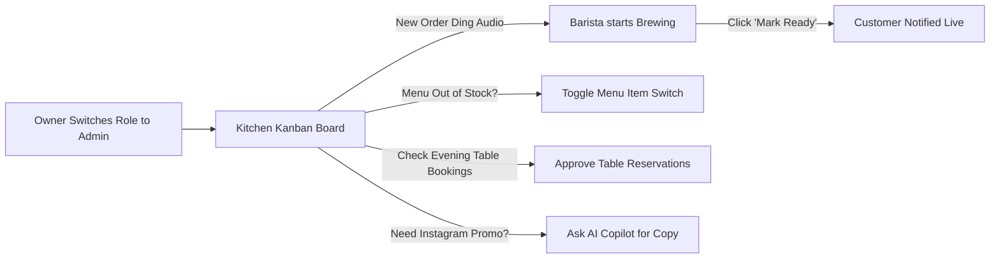

# Development Structure & UI/UX Planning
## Project: ShopMate AI — AI-Powered Café Ordering & Customer Support Bot
**Bespoke Artisanal Visual Identity & Interaction Specification**  
**Document Version:** 1.0.0  

---

### 1. UI/UX Design Philosophy: "Velvet Espresso & Warm Amber"
Modern generic corporate SaaS templates with cold blues and sterile whites fail to capture the warm, comforting atmosphere of an artisan café. ShopMate AI combines tactile coffee culture with high-tech glassmorphism and ambient lighting.

#### 1.1 Color Palette & Token System
- **Espresso Dark (Background Base):** `#12100E` (Deep roasted coffee bean)
- **Mocha Surface (Card Background):** `#1E1A16` with `rgba(255, 255, 255, 0.04)` glass borders
- **Amber Gold (Primary Accent):** `#F59E0B` / `#D97706` (Honey crema glow)
- **Latte Cream (Secondary Text):** `#F3E8D6` (Smooth milk foam)
- **Fresh Mint (Success / Fresh Indicator):** `#10B981` (Fresh mint sprig)
- **Berry Glaze (Alert / Urgent):** `#EF4444` (Raspberry tart)
- **Warm Shadow:** `0 12px 36px -8px rgba(0, 0, 0, 0.6), 0 0 24px rgba(245, 158, 11, 0.12)`

#### 1.2 Typography
- **Headings & Display:** `Cabinet Grotesk` / `Outfit` / `Plus Jakarta Sans` — bold, friendly, modern geometric sans-serif.
- **Body & Data:** `Inter` / system-ui — ultra legible at micro-sizes (nutrition tags, item notes, timers).

---

### 2. User Journey & Flow Maps

#### 2.1 Customer Journey: "Instant Delight in 3 Clicks"

```mermaid
graph LR
    A[Visitor on Landing] -->|Clicks 'Explore Menu'| B[Artisan Menu Catalog]
    B -->|Search / Filter Dietary| C[Select Item & Customize]
    C -->|Milk, Sweetness, Temp| D[Add to Slide-out Cart]
    D -->|Apply 'FIRSTSIP' Promo| E[Simulate Payment & Order]
    E -->|Confetti Pop| F[Live 4-Stage Brewing Tracker]
    F -->|Chat Assistant Tab| G[Ask ShopMate AI for Updates]
```

#### 2.2 Café Owner Journey: "Kitchen Harmony & Real-time Control"

---

### 3. Screen-by-Screen UI/UX Specifications

#### 3.1 Top Navigation Bar (Omnipresent)
- **Left:** Brand logo with glowing coffee cup glyph, brand title **ShopMate AI**, and live pulse indicator ("Open 7am–11pm").
- **Center:** Navigation links: *Storefront / Menu*, *Live Kitchen Kanban*, *Table Booking*, *Owner Dashboard*.
- **Right:**
  - Role Switcher toggle: `Customer (Alex)` ⇋ `Owner (Admin)`.
  - Sound Alert toggle: Mute / Unmute subtle chimes.
  - Cart Launcher button with glowing badge showing item count & total.
  - User Avatar & Quick 1-Click Demo Login button.

#### 3.2 Hero & Landing Section
- Dynamic hero banner with animated coffee steam effect.
- Headline: *"Turn Your Café Into a 24/7 Smart Ordering Hub with Conversational AI."*
- Subheadline: *"Instant orders, zero missed WhatsApp inquiries, and automated table reservations at ₹499/month."*
- Dual CTA: `Order Now (Live Demo)` and `Explore Owner Dashboard`.
- Real-time stat counters: `4.9 ★ Rating`, `10,000+ Cups Ordered`, `< 1s AI Response`.

#### 3.3 Menu Showcase & Customization Modal
- Category pills with emoji icons (☕ Artisanal Coffees, 🍵 Specialty Teas, 🥐 Bakery & Pastries, 🥪 Gourmet Sandwiches, 🥗 Healthy Bowls).
- Dietary tag badges with color coding (Green: Vegan, Amber: Gluten-Free, Purple: Chef's Special).
- Search bar with instant real-time filtering as the user types.
- Product card with hover scale, crisp image, price in ₹, star rating, and "Customize & Add" button.
- Customizer Modal:
  - Milk selection (Whole Milk, Oat Milk +₹30, Almond Milk +₹30).
  - Sweetness selector (Unsweetened 0%, Balanced 50%, Sweet 100%).
  - Serving Style (Hot or Iced with cubes).
  - Special Barista instructions input.

#### 3.4 Slide-out Cart Drawer
- Smooth slide from right with blur backdrop.
- Item list with quantity stepper (+ / -), customizations summary, and delete button.
- Promo code input with instant validation and applied discount pill.
- Dine-in / Takeaway / Delivery selector with Table Number field.
- Price breakdown: Subtotal, 5% GST, Promo Discount, Total Payable.
- Primary CTA: *"Place Order — ₹[Total]"* with loading spinner, audio feedback, and confetti celebration!

#### 3.5 Live Brewing Order Tracker
- Visual step progression:
  1. `Order Received` (Kitchen notified)
  2. `Barista Brewing` (Artisanal preparation underway)
  3. `Ready for Pickup / Serving` (Fresh & hot at counter)
  4. `Served & Completed`
- Live estimated countdown timer.
- Order details breakdown and "Ask ShopMate AI about this order" direct button.

#### 3.6 ShopMate AI Floating Concierge
- Fixed bottom-right glowing floating bubble with subtle pulse animation.
- Expandable chat modal with clean header, status badge, sound toggle, and clear chat button.
- Message bubbles with timestamps and markdown formatting.
- Interactive Suggestion Chips:
  - ☕ *"What's your best cold brew?"*
  - 🥐 *"Show vegan breakfast options"*
  - 🕒 *"What are your opening hours & Wi-Fi?"*
  - 🛒 *"Add a Cappuccino and Butter Croissant to cart"*
- Real-time action triggers: Directly updates the shopping cart or opens the reservation dialog!

#### 3.7 Admin & Kitchen Operations Dashboard
- **Header:** Live shift status, Today's Gross Revenue, Active Orders count, AI chat deflection rate.
- **Tab 1: Kitchen Kanban:**
  - Columns: New Orders, Brewing, Ready, Completed.
  - Order cards show order ID, customer name, items with customizations, order type (Dine-in Table #), elapsed time badge.
  - Action buttons to move between stages with 1 click.
- **Tab 2: Menu Management:**
  - Visual grid of all dishes and beverages.
  - One-click "In Stock" / "Sold Out" toggle.
  - "Add New Item" modal with image preview, price, dietary flags.
  - Edit and Delete item capabilities.
- **Tab 3: Reservations:**
  - Table booking cards with customer name, party size, time, date, and seating preference.
  - Quick action to Mark Seated or Cancel.
- **Tab 4: Business Analytics:**
  - Gross sales breakdown, average order value, popular item rankings, customer satisfaction score.
- **Tab 5: AI Owner Copilot & Settings:**
  - Generate promotional copy for Instagram/WhatsApp.
  - Configure café details (Hours, Wi-Fi, UPI ID, Google Gemini API key).

---

### 4. Accessibility & Micro-Interactions
- Smooth CSS transitions (`transition: all 0.25s cubic-bezier(0.16, 1, 0.3, 1)`).
- Clear keyboard navigation and focus rings (`outline: 2px solid #F59E0B`).
- High-contrast text labels ensuring legibility in bright sunlight or dark rooms.
