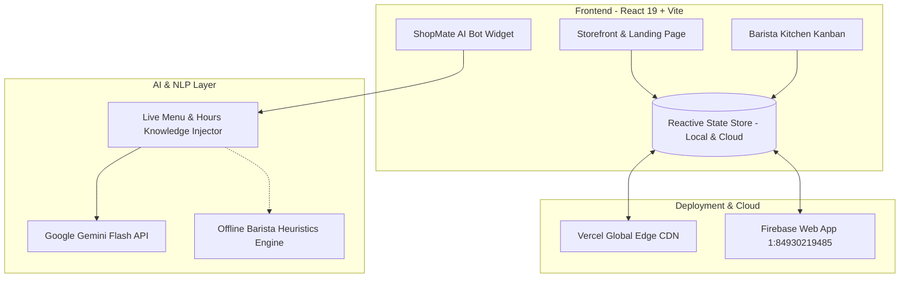

# ☕ ShopMate AI — AI-Powered Café Ordering & Barista Operations
### REVHACK 2026 | 5-Minute Pitch Project · Idea #10: Local Commerce SaaS (₹499/month)

[](https://shopmateai.vercel.app)
[](https://shopmateai.vercel.app)
[](https://shopmateai.vercel.app)

---

## 🌐 Live Production Application

> **Primary Public Production URL:** **[https://shopmateai.vercel.app](https://shopmateai.vercel.app)**  
> **Secondary Production Mirror:** **[https://shopmate-ai-tau.vercel.app](https://shopmate-ai-tau.vercel.app)**  
> **Local Dev Server:** `http://127.0.0.1:5173/`

---

## 📌 Executive Summary & Problem Statement

Small-to-medium independent cafés, artisan roasters, and neighbourhood bakeries lose an estimated **20% to 35% of daily takeaway and table orders** because baristas are busy pulling espresso shots or steaming milk, leaving digital inquiries (WhatsApp messages, Instagram DMs, and phone calls) unanswered.

### The 3 Core Pain Points:
1. **Delayed Responses:** Customers abandon orders when queries about opening hours, Wi-Fi, table availability, or vegan options go unanswered.
2. **Repetitive Workload:** Owners spend 2.5+ hours daily answering the exact same routine questions.
3. **Manual Order Errors & High Commissions:** Orders scribbled on napkins cause kitchen delays, while third-party food aggregators take 20%–30% in commission fees.

---

## 🚀 The 7 Unique Killer Features

```
┌────────────────────────────────────────────────────────────────────────┐
│                        SHOPMATE AI ECOSYSTEM                           │
├──────────────────────────┬─────────────────────────────────────────────┤
│ 1. Smart Order Recovery  │ Suggests alternatives on out-of-stock items │
│ 2. Multilingual Ordering │ Colloquial Kannada + English (Kanglish)     │
│ 3. Budget Meal Planner   │ Calculates verified combos under ₹150 / ₹300│
│ 4. Owner Intelligence    │ Proactive rush alerts & inventory restocks  │
│ 5. Dynamic ETA Estimator │ Live prep time + kitchen queue calculation  │
│ 6. Trustworthy AI Engine │ Grounded in DB — Zero price hallucinations  │
│ 7. Preference Memory     │ Transparent customer taste & dietary memory │
└──────────────────────────┴─────────────────────────────────────────────┘
```

### Feature 1: Smart Order Recovery (Top Pick)
- **Sold Out Handling:** When a guest asks for an item that is out-of-stock (e.g. *Dark Chocolate Sea Salt Brownie*), the AI never dead-ends. It explains the batch finished and offers warm in-stock alternatives (*Flaky Butter Croissant ₹160* or *Almond Frangipane Tart ₹210*).
- **Abandoned Bag Recovery:** If a customer adds items to their cart and pauses, a floating banner offers a 1-click restore before their brew slot resets.

### Feature 2: Local-Language Ordering (Kannada + English)
- Understands local Bengaluru speech patterns and colloquial Kannada:
  - *"Ondu filter coffee kodi"* ➔ Adds 1x Classic Chikmagalur Filter Coffee (₹80).
  - *"Eradu masala chai beku"* ➔ Adds 2x Cardamom Spiced Masala Chai (₹140).
  - *"Oota enide?"* ➔ Lists available craft bakery and snacks in Kannada & English.

### Feature 3: Smart Budget Meal Planner
- Customer asks: *"What can I order for less than 150 rupees?"*
- Calculates mathematically verified menu items from the database (e.g., *1x Classic Filter Coffee ₹80 + 1x Cardamom Masala Chai ₹70 = ₹150 exact!*), completely eliminating price hallucinations.

### Feature 4: Café Owner Intelligence & Decision Support
- Located in the **Owner Dashboard ➔ AI Marketing Copilot & Analytics**.
- Identifies the 8:30–11:00 AM rush, top-selling cold brews, and issues proactive operational advice (e.g. *"Pre-brew 12 bottles of Cold Brew for tomorrow's morning rush"* and *"Reorder Barista Oat Milk"*).

### Feature 5: Realistic Pickup-Time Estimator
- Dynamic formula: `Max(Selected Item Prep Times) + (2.5 mins × Active Tickets in Kitchen Queue)`.
- Live countdown displayed in the cart drawer and order tracking screen.

### Feature 6: Trustworthy AI with Source-Based Answers
- All prices and items originate strictly from the verified menu catalog.
- If out-of-scope items (e.g. pizza, sushi) are requested, the AI admits it and recommends the closest craft menu item (*Truffle Wild Mushroom Sourdough Melt ₹290*).

### Feature 7: Customer Preference Memory
- Remembers dietary flags (Vegetarian/Vegan), preferred milk (Oat/Almond), sweetness level, and usual budget.
- Click **`🧠 Memory`** in the top navbar to inspect, modify, or erase your stored AI profile anytime.

---

## 🏆 REVHACK 5-Minute Pitch Walkthrough

Click the glowing **`REVHACK Judge Demo`** button in the top navbar to open the interactive pitch simulator:

```mermaid
journey
    title 5-Minute Judge Pitch Flow
    section 0:00 - 0:30 (Hook)
      Judges hear busy café phone problem: 5: Customer
    section 0:30 - 1:05 (Pain Points)
      Delayed response & lost orders: 4: Customer, Owner
    section 1:05 - 2:00 (Solution)
      Customer chat + Owner dashboard: 5: Customer, Owner
    section 2:00 - 2:40 (Live Demo)
      Kannada ordering & Budget under ₹150: 5: Customer
    section 2:40 - 3:20 (Tech Stack)
      React 19, Gemini Flash, Firebase: 5: System
    section 3:20 - 4:00 (Business Model)
      Flat ₹499/mo SaaS & ROI calculator: 5: Owner
    section 4:00 - 5:00 (Closing)
      Validation & Q&A: 5: Judges
```

---

## 🛠️ Technology Stack Architecture



- **Frontend:** React 19, Vite, Modern CSS Design Tokens (Velvet Espresso & Amber Crema theme, glassmorphism).
- **Icons & Effects:** `lucide-react`, `canvas-confetti`.
- **AI Engine:** Google Gemini Flash API (`gemini-1.5-flash`) + Local Fallback Barista Heuristics.
- **Audio Synthesizer:** Web Audio API generating bell chimes and tactile sound effects without external MP3 dependencies.
- **Cloud Configuration:** Firebase Web App ID `1:84930219485:web:9c7a8b6e4d2f01a3`.
- **Deployment:** Vercel Global Edge Network with custom SPA rewrites.

---

## 📂 Project Directory Structure

```
c:/Users/anjan/Downloads/SHOP MATE/
├── public/
│   └── favicon.svg                  # Brand coffee cup vector icon
├── src/
│   ├── components/
│   │   ├── admin/
│   │   │   └── AdminDashboard.jsx   # Live Kanban, Menu CRUD, Analytics, AI Copilot
│   │   ├── chatbot/
│   │   │   └── ChatWidget.jsx       # Floating Gemini bot with Kannada & chips
│   │   ├── common/
│   │   │   ├── AuthModal.jsx        # Multi-role auth + 1-Click Demo Logins
│   │   │   ├── Footer.jsx           # Café info, Wi-Fi pass, tech stack
│   │   │   ├── JudgePitchSimulator.jsx # REVHACK 5-minute interactive pitch player
│   │   │   ├── Navbar.jsx           # Live pulse, role toggle, memory badge
│   │   │   └── Toast.jsx            # Notification banners
│   │   ├── customer/
│   │   │   ├── CartDrawer.jsx       # Slide-out checkout + dynamic ETA
│   │   │   ├── ItemModal.jsx        # Drink customizer (milk, sugar, temp)
│   │   │   ├── MenuCatalog.jsx      # Search, category pills, dietary tags
│   │   │   ├── OrderRecoveryBanner.jsx # Feature #1 Smart Order Recovery
│   │   │   ├── OrderTracker.jsx     # Live 4-stage brewing progress
│   │   │   └── PreferenceMemoryModal.jsx # Feature #7 AI taste memory
│   │   └── landing/
│   │       ├── FeaturesGrid.jsx     # 6 core pillars
│   │       ├── HeroSection.jsx      # High-conversion hero with steam glow
│   │       ├── PricingSection.jsx   # ₹499/mo plan + interactive ROI calculator
│   │       └── Testimonials.jsx     # Real coffee roaster reviews
│   ├── context/
│   │   ├── AuthContext.jsx          # User roles (Customer vs Barista)
│   │   └── StoreContext.jsx         # Unified reactive state engine
│   ├── data/
│   │   └── mockData.js              # Menu items, Kannada vocabulary, pitch data
│   ├── services/
│   │   ├── audioService.js          # Web Audio synth for kitchen bells
│   │   ├── firebase.js              # Firebase Web config (1:84930219485)
│   │   └── geminiService.js         # Google Gemini Flash connector
│   ├── styles/
│   │   ├── animations.css           # Steam float, shimmer, pulse glow
│   │   ├── components.css           # Glass panels, badges, form inputs
│   │   └── design-tokens.css        # Bespoke color palette & typography
│   ├── App.jsx                      # App router & modal mounting
│   ├── main.jsx                     # Entry mounting providers
│   └── index.css                    # Global typography & layout
├── DEVELOPMENT_STRUCTURE_AND_UI_UX_PLAN.md
├── PRD.md                           # Product Requirements Document
├── SRS.md                           # Software Requirements Specification
├── TRD.md                           # Technical Requirements Document
├── vercel.json                      # Vercel SPA rewrite & security configuration
└── render.yaml                      # Render static site configuration
```

---

## 💻 Running Locally

```bash
# 1. Install dependencies
npm install

# 2. Launch Vite development server
npm run dev
```

Open `http://127.0.0.1:5173/` in your browser.

---

## 👥 Demo Profiles Included

- **Customer:** `Alex Morgan` (`alex.coffee@gmail.com`)
- **Café Owner & Barista:** `Viraj Bagul` (`owner@brewbliss.com`)

Switch between profiles anytime using the **Customer ⇋ Owner** toggle pill in the top navigation bar!
