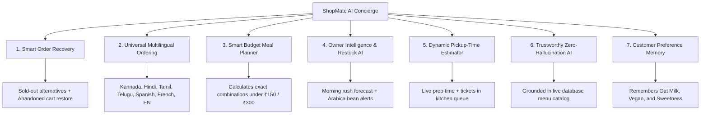
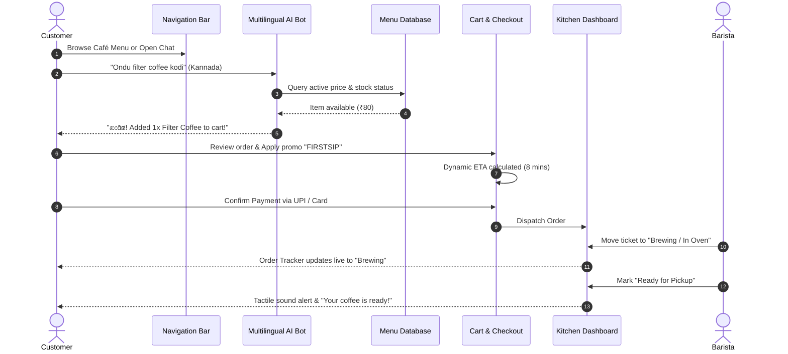
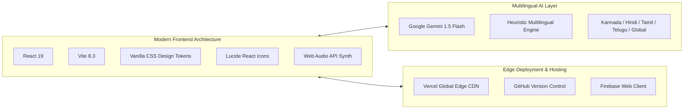

# ☕ ShopMate.AI — AI-Powered Café Ordering, Multilingual Concierge & Barista Kitchen Operations
### Next-Generation Conversational Commerce for Independent Cafés & Artisan Roasters

[](https://shopmateai.vercel.app)
[](https://github.com/codexanjan/shopmateai)
[](https://shopmateai.vercel.app)
[](https://shopmateai.vercel.app)

---

## 🌐 Live Production Application

> **Primary Live Production URL:** **[https://shopmateai.vercel.app](https://shopmateai.vercel.app)**  
> **Secondary Production Mirror:** **[https://shopmate-ai-tau.vercel.app](https://shopmate-ai-tau.vercel.app)**  
> **GitHub Repository:** **[https://github.com/codexanjan/shopmateai](https://github.com/codexanjan/shopmateai)**  
> **Local Dev Server:** `http://127.0.0.1:5173/`

---

## 📸 App Architecture & Visual Pages Overview

ShopMate AI is structured into **clean, dedicated standalone pages** and views:

| Page / View | Route State | Purpose & Features |
| :--- | :--- | :--- |
| **🏠 Separate Landing Page** | `landing` | High-converting public showcase, value proposition, 7 AI superpowers, live café stats ticker, transparent pricing comparison (₹499/mo vs 30% commission), customer testimonials. |
| **☕ Separate Café Menu Page** | `menu` | Artisanal beverage & food catalog, category tabs (Espresso, Cold Brew, Bakery, Brunch), dietary pills (Vegan 🌱, Gluten-Free 🌾, Chef's Special 🌟), search, item customization modal. |
| **📅 Separate Table Booking Page** | `table` | Dedicated table reservation experience, atmosphere selector (🌿 Sunlit Pet-Friendly Patio, ☕ Indoor Cozy Booth, 💻 Quiet Work Zone with 300 Mbps Wi-Fi & outlets), instant confirmation. |
| **⏱️ Separate Order Tracker Page** | `tracker` | Live 4-stage brewing progress (Order Placed ➔ Brewing / In Oven ➔ Quality Check ➔ Ready for Pickup), dynamic preparation countdown timer, barista status. |
| **📊 Separate Owner & Kitchen Dashboard** | `admin` | Live Kitchen Kanban dispatch board (Pending, Brewing, Ready, Delivered), sales & order metrics, AI Inventory Restock alerts, Menu item availability toggle (instantly syncs with AI recovery). |
| **🔑 Separate Login & Signup Page** | `auth` | Standalone split-screen authentication portal, toggle between Sign In and Create Account, 1-Click Instant Demo Logins (Customer, Café Owner, Barista Staff), form validation, role routing. |

---

## 🌐 Universal Multilingual Chatbot (Answers in ALL Languages)

ShopMate AI's conversational concierge is equipped with **universal multilingual intelligence**:

```
┌─────────────────────────────────────────────────────────────────────────┐
│                    SHOPMATE AI MULTILINGUAL CONCIERGE                   │
├──────────────────────────┬──────────────────────────────────────────────┤
│ 🌐 Auto-Detect Engine    │ Automatically detects ANY world language     │
│ 🇮🇳 Kannada (ಕನ್ನಡ)       │ "Ondu filter coffee kodi", "Oota enide?"    │
│ 🇮🇳 Hindi (हिंदी)         │ "Do masala chai chahiye", "Menu me kya hai?" │
│ 🇮🇳 Tamil (தமிழ்)         │ "Oru filter coffee kudunga", "Vanakkam"      │
│ 🇮🇳 Telugu (తెలుగు)       │ "Oka French croissant ivvandi"               │
│ 🇪🇸 Spanish (Español)     │ "Hola, un café con leche de avena por favor" │
│ 🇫🇷 French (Français)     │ "Bonjour, un croissant et un café filtre"    │
│ 🇩🇪 German (Deutsch)      │ "Guten Tag, einen Filterkaffee bitte"        │
└──────────────────────────┴──────────────────────────────────────────────┘
```

- **Zero Hallucination Grounding:** Prices are always grounded in live database prices in Indian Rupees (₹).
- **Hinglish, Kanglish & Tanglish Support:** Accurately recognizes transliterated phonetic phrases.
- **Language Selector Ribbon:** Floating drawer features quick-toggle language tabs and localized suggestion chips.

---

## 🚀 The 7 Core Killer Features



### 1. Smart Order Recovery
When a customer requests an out-of-stock item (e.g. *Dark Chocolate Sea Salt Brownie*), the AI concierge never stops with a dead-end rejection. It explains that the morning batch finished and recommends in-stock chef alternatives (*Flaky French Butter Croissant ₹160* or *Almond Frangipane Tart ₹210*).

### 2. Universal Multilingual Ordering
Customers can order fluently in their native tongue. Whether typing *"Ondu filter coffee kodi"* (Kannada) or *"Do masala chai aur pastry chahiye"* (Hindi), the AI understands quantities, prepares the order, and updates the cart with 1 click.

### 3. Smart Budget Meal Planner
Ask *"Suggest a combo under 150 rupees"*, and the AI calculates mathematically exact combinations from active inventory (e.g. *Classic Filter Coffee ₹80 + Cardamom Chai ₹70 = ₹150 Exact*).

### 4. Café Owner Decision Support
The Owner Dashboard features proactive intelligence: analyzes sales velocity, forecasts morning rush spikes (8:30 AM – 11:00 AM), and warns when supplies (like Barista Oat Milk or Arabica Beans) drop below threshold.

### 5. Dynamic Pickup-Time Estimator
Instead of a static "20 mins", ETA is computed dynamically:
$$\text{ETA} = \max(\text{Selected Item Prep Times}) + (2.5\text{ mins} \times \text{Active Kitchen Queue Tickets})$$

### 6. Trustworthy AI Grounded in Reality
If an out-of-scope item is asked for (e.g. sushi, pizza, biryani), the AI politely clarifies that Brew & Bliss specializes in artisanal coffee and fresh bakery, offering the closest relevant craft item.

### 7. Customer Preference Memory
Remembers dietary preferences (Vegan, Gluten-Free), preferred milk (Oat Milk), and usual budget. Customers can click **`🧠 Memory`** in the navigation bar to inspect, edit, or reset their saved taste profile at any time.

---

## 🔄 End-to-End Workflow Diagram



---

## 🛠️ Complete Tech Stack



- **Frontend Core:** React 19, Vite, HTML5, Vanilla CSS with HSL design tokens, Glassmorphism.
- **Icons & Tactile Feedback:** `lucide-react`, Web Audio API sound synthesizer (zero external MP3 dependencies).
- **AI Engine:** Google Gemini 1.5 Flash API + Resilient Multilingual Fallback Engine.
- **Cloud Backend:** Firebase Web configuration (`1:84930219485:web:9c7a8b6e4d2f01a3`).
- **Edge CDN:** Vercel Global Edge Network with custom SPA rewrites (`vercel.json`).

---

## 💻 Local Development Setup

```bash
# 1. Clone repository
git clone https://github.com/codexanjan/shopmateai.git
cd shopmateai

# 2. Install dependencies
npm install

# 3. Start local development server
npm run dev
```

Visit `http://127.0.0.1:5173/` in your browser.

To create an optimized production build:
```bash
npm run build
```

---

## 👥 Demo Profiles Included

- **Customer Demo:** `Alex Morgan` (`alex.coffee@gmail.com`) — Pre-loaded with Oat Milk & Cold Brew preferences.
- **Café Owner & Admin:** `Viraj Bagul` (`owner@brewbliss.com`) — Full access to Kitchen Kanban, Inventory, & AI Copilot.

Switch between profiles instantly using the **Customer ⇋ Owner** toggle pill or via the dedicated **Sign In / Register** page (`currentView === "auth"`).

---

## 📜 Complete Documentation Suite

- [PRD.md](file:///c:/Users/anjan/Downloads/SHOP%20MATE/PRD.md) — Product Requirements Document
- [SRS.md](file:///c:/Users/anjan/Downloads/SHOP%20MATE/SRS.md) — Software Requirements Specification
- [TRD.md](file:///c:/Users/anjan/Downloads/SHOP%20MATE/TRD.md) — Technical Requirements Document
- [DEVELOPMENT_STRUCTURE_AND_UI_UX_PLAN.md](file:///c:/Users/anjan/Downloads/SHOP%20MATE/DEVELOPMENT_STRUCTURE_AND_UI_UX_PLAN.md) — UI/UX & Design Tokens

---

## ⚖️ License

Crafted with ❤️ for independent local cafés and passionate coffee roasters. Distributed under the MIT License.
