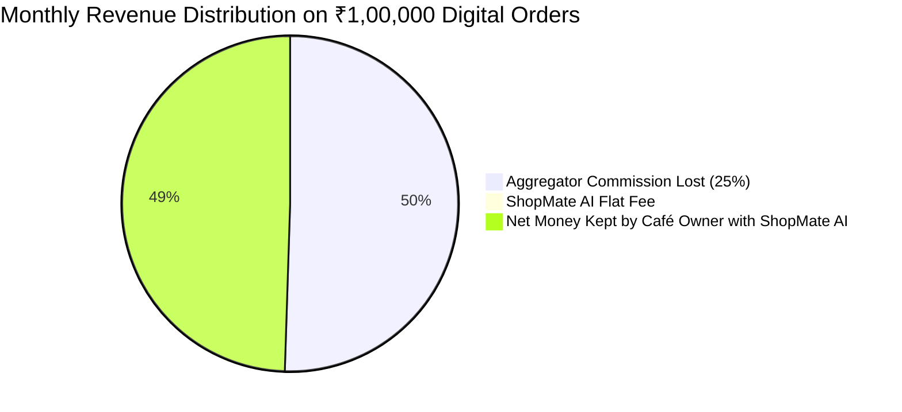
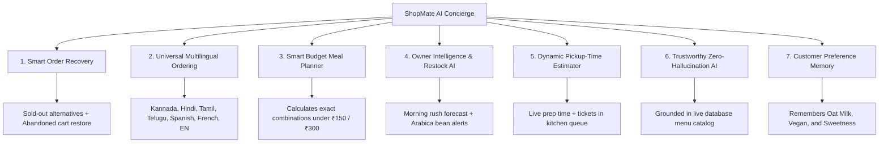
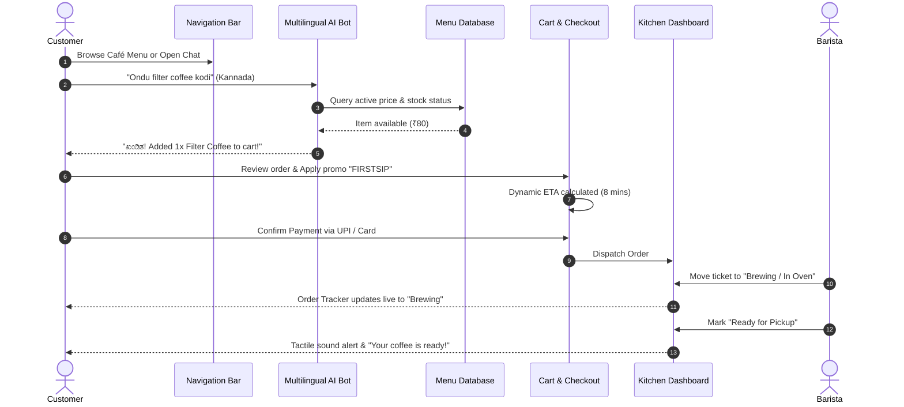
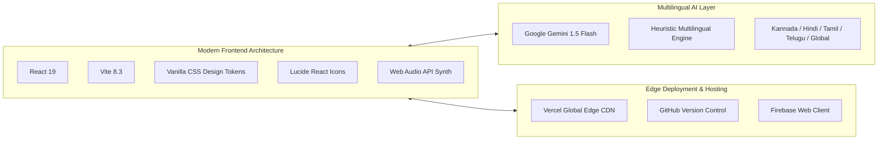

# ☕ ShopMate.AI — AI-Powered Café Ordering, Multilingual Concierge & Barista Kitchen Operations
### Next-Generation Conversational Commerce for Independent Cafés & Artisan Roasters

[](https://shopmateai.vercel.app)
[](https://github.com/codexanjan/shopmateai)
[](https://shopmateai.vercel.app)
[](https://shopmateai.vercel.app)

---

## 🌐 Live Production Application Links

> 🚀 **Primary Live Production URL:** **[https://shopmateai.vercel.app](https://shopmateai.vercel.app)**  
> 🪞 **Secondary Production Mirror:** **[https://shopmate-ai-tau.vercel.app](https://shopmate-ai-tau.vercel.app)**  
> 📦 **GitHub Repository:** **[https://github.com/codexanjan/shopmateai](https://github.com/codexanjan/shopmateai)**  
> 💻 **Local Development Server:** `http://127.0.0.1:5173/`

---

## 📸 Visual App Showcase & Photo Gallery

| View | Screenshot / Visual | Key Capabilities |
| :--- | :--- | :--- |
| **🏠 Separate Landing Page** |  | • High-conversion hero with coffee crema aesthetics<br>• Live café pulse indicator & operating hours<br>• 7 AI superpowers breakdown & 4-stat metric ticker<br>• Transparent ₹499/mo vs 25% aggregator fee calculator |
| **☕ Separate Café Menu Page** |  | • Category filters: Espresso, Cold Brew, Bakery, Brunch<br>• Dietary badges: Vegan 🌱, Gluten-Free 🌾, Chef's Choice 🌟<br>• Customizer modal: Milk (Oat/Almond), sweetness, notes<br>• Smart Order Recovery banner for sold-out items |
| **📅 Separate Table Booking Page** |  | • 🌿 Sunlit Garden Patio (100% Pet-Friendly)<br>• ☕ Indoor Cozy Booths with warm ambient velvet banquettes<br>• 💻 Quiet Work Zone with 300 Mbps Wi-Fi & power outlets<br>• Instant booking confirmation with Wi-Fi credentials |
| **📊 Kitchen & Admin Dashboard** |  | • 4-column Live Kitchen Kanban (Pending, Brewing, Ready, Completed)<br>• Tactile sound notifications with Web Audio synth<br>• Predictive AI Inventory restock alerts (e.g. Oat Milk, Arabica)<br>• Real-time stock toggle syncing with AI chatbot |
| **⏱️ Live Order Brewing Tracker** |  | • Real-time 4-step brewing pipeline with progress bar<br>• Dynamic prep time countdown: `Max(Prep Time) + 2.5m * Queue`<br>• Barista status & direct UPI invoice receipts |
| **🔑 Separate Login & Signup Page** |  | • Dedicated split-screen auth experience<br>• 1-Click Instant Demo Profiles (Alex - Customer, Viraj - Owner)<br>• Tab toggle: Sign In vs Create Account<br>• Role-based automatic routing to Menu or Dashboard |

---

## 💰 How Our Revenue Model Works (Transparent B2B SaaS)

Small cafés, artisan roasters, and neighbourhood bakeries operate on razor-thin net profit margins (typically **12% to 18%**).

### 1. The Core Problem with Food Aggregators (Swiggy, Zomato, UberEats)
- **Extortionate Commissions:** Food aggregators take **20% to 30% of gross order value** on every single transaction.
- **Lost Customer Data:** Aggregators own customer emails and phone numbers, preventing the café from building loyalty.
- **Hidden Fees:** Menu price inflation, surge fees, and payment gateway markups irritate customers.

### 2. The ShopMate AI Revenue Architecture
ShopMate AI replaces predatory commissions with a predictable, flat-rate **Subscription SaaS Model**:

```
┌────────────────────────────────────────────────────────────────────────┐
│                        SHOPMATE AI REVENUE MODEL                       │
├────────────────────────────────┬───────────────────────────────────────┤
│ 1. Core Tier (Per Location)    │ Flat ₹499 / month (14-day Free Trial) │
│ 2. Annual Discount             │ ₹4,999 / year (Save 17% / 2 Mo Free)  │
│ 3. Commission Rate on Orders   │ 0% FOREVER (Direct Customer UPI)      │
│ 4. Multi-Outlet Add-On         │ +₹999 / month for up to 3 branches   │
│ 5. WhatsApp API Gateway Add-on │ +₹1,499 / month (Meta Cloud API Bridge│
└────────────────────────────────┴───────────────────────────────────────┘
```

### 3. The Café Owner ROI Savings Math



| Monthly Online Sales | Aggregator Cut (25%) | ShopMate AI Flat Fee | Monthly Net Savings | Annual Profit Increase |
| :--- | :--- | :--- | :--- | :--- |
| **₹50,000 / mo** | ₹12,500 | ₹499 | **₹12,001 / mo** | **₹1,44,012 / year** |
| **₹1,00,000 / mo** | ₹25,000 | ₹499 | **₹24,501 / mo** | **₹2,94,012 / year** |
| **₹2,50,000 / mo** | ₹62,500 | ₹499 | **₹62,001 / mo** | **₹7,44,012 / year** |
| **₹5,00,000 / mo** | ₹1,25,000 | ₹499 | **₹1,24,501 / mo** | **₹14,94,012 / year** |

> 💡 **Key Takeaway:** A small café doing just ₹1,00,000/month in digital takeaway orders saves over **₹2.94 Lakhs per year** simply by switching from a 25% aggregator commission to ShopMate AI's flat ₹499/mo plan!

---

## 🌐 Universal Multilingual Chatbot (Answers in ALL Languages)

ShopMate AI's conversational concierge is equipped with **universal multilingual natural language understanding**:

```
┌─────────────────────────────────────────────────────────────────────────┐
│                    SHOPMATE AI MULTILINGUAL CONCIERGE                   │
├──────────────────────────┬──────────────────────────────────────────────┤
│ 🌐 Auto-Detect Engine    │ Automatically detects ANY world language     │
│ 🇮🇳 Kannada (ಕನ್ನಡ)       │ "Ondu filter coffee kodi", "Oota enide?"    │
│ 🇮🇳 Hindi (हिंदी)         │ "Do masala chai chahiye", "Menu me kya hai?" │
│ 🇮🇳 Tamil (தமிழ்)         │ "Oru filter coffee kudunga", "Vanakkam"      │
│ 🇮🇳 Telugu (తెలుగు)       │ "Oka French croissant ivvandi"               │
│ 🇪🇸 Spanish (Español)     │ "Hola, un café con leche de avena por favor" │
│ 🇫🇷 French (Français)     │ "Bonjour, un croissant et un café filtre"    │
│ 🇩🇪 German (Deutsch)      │ "Guten Tag, einen Filterkaffee bitte"        │
└──────────────────────────┴──────────────────────────────────────────────┘
```

- **Zero Hallucination Grounding:** Prices and availability strictly reflect the live menu database in Indian Rupees (₹).
- **Hinglish, Kanglish & Tanglish Support:** Accurately recognizes transliterated phonetic phrases.
- **Language Selector Ribbon:** Floating drawer features quick-toggle language tabs and localized suggestion chips.

---

## 🚀 The 7 Core Killer Features



### 1. Smart Order Recovery
When a customer requests an out-of-stock item (e.g. *Dark Chocolate Sea Salt Brownie*), the AI concierge never gives a dead-end rejection. It explains that the morning batch finished and recommends in-stock chef alternatives (*Flaky French Butter Croissant ₹160* or *Almond Frangipane Tart ₹210*).

### 2. Universal Multilingual Ordering
Customers can order fluently in their native tongue. Whether typing *"Ondu filter coffee kodi"* (Kannada) or *"Do masala chai aur pastry chahiye"* (Hindi), the AI understands quantities, prepares the order, and updates the cart with 1 click.

### 3. Smart Budget Meal Planner
Ask *"Suggest a combo under 150 rupees"*, and the AI calculates mathematically exact combinations from active inventory (e.g. *Classic Filter Coffee ₹80 + Cardamom Chai ₹70 = ₹150 Exact*).

### 4. Café Owner Decision Support
The Owner Dashboard features proactive intelligence: analyzes sales velocity, forecasts morning rush spikes (8:30 AM – 11:00 AM), and warns when supplies (like Barista Oat Milk or Arabica Beans) drop below threshold.

### 5. Dynamic Pickup-Time Estimator
Instead of a static "20 mins", ETA is computed dynamically:
$$\text{ETA} = \max(\text{Selected Item Prep Times}) + (2.5\text{ mins} \times \text{Active Kitchen Queue Tickets})$$

### 6. Trustworthy AI Grounded in Reality
If an out-of-scope item is asked for (e.g. sushi, pizza, biryani), the AI politely clarifies that Brew & Bliss specializes in artisanal coffee and fresh bakery, offering the closest relevant craft item.

### 7. Customer Preference Memory
Remembers dietary preferences (Vegan, Gluten-Free), preferred milk (Oat Milk), and usual budget. Customers can click **`🧠 Memory`** in the navigation bar to inspect, edit, or reset their saved taste profile at any time.

---

## 🔄 End-to-End Workflow Diagram



---

## 🛠️ Complete Tech Stack



- **Frontend Core:** React 19, Vite, HTML5, Vanilla CSS with HSL design tokens, Glassmorphism.
- **Icons & Tactile Feedback:** `lucide-react`, Web Audio API sound synthesizer (zero external MP3 dependencies).
- **AI Engine:** Google Gemini 1.5 Flash API + Resilient Multilingual Fallback Engine.
- **Cloud Backend:** Firebase Web configuration (`1:84930219485:web:9c7a8b6e4d2f01a3`).
- **Edge CDN:** Vercel Global Edge Network with custom SPA rewrites (`vercel.json`).

---

## 💻 Local Development Setup

```bash
# 1. Clone repository
git clone https://github.com/codexanjan/shopmateai.git
cd shopmateai

# 2. Install dependencies
npm install

# 3. Start local development server
npm run dev
```

Visit `http://127.0.0.1:5173/` in your browser.

To create an optimized production build:
```bash
npm run build
```

---

## 👥 Demo Profiles Included

- **Customer Demo:** `Alex Morgan` (`alex.coffee@gmail.com`) — Pre-loaded with Oat Milk & Cold Brew preferences.
- **Café Owner & Admin:** `Viraj Bagul` (`owner@brewbliss.com`) — Full access to Kitchen Kanban, Inventory, & AI Copilot.

Switch between profiles instantly using the **Customer ⇋ Owner** toggle pill or via the dedicated **Sign In / Register** page (`currentView === "auth"`).

---


## ⚖️ License

Crafted with ❤️ for independent local cafés and passionate coffee roasters. Distributed under the MIT License.
