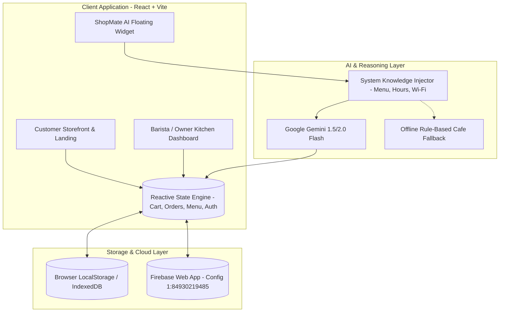

# Technical Requirements Document (TRD) & Architecture
## Project: ShopMate AI — AI-Powered Café Ordering & Customer Support Bot
**Architecture Blueprint & Technical Implementation Guide**  
**Document Version:** 1.0.0  

---

### 1. Technology Stack Architecture

| Layer | Technology | Rationale & Selection Criteria |
| :--- | :--- | :--- |
| **Frontend Framework** | React 19 + Vite 6 | Lightning-fast HMR (<100ms), zero runtime bundle bloat, production grade |
| **Styling & Design System** | Vanilla Modern CSS (CSS Variables, Glassmorphism, BEM tokens) | High-performance 60fps rendering, custom bespoke artisan café theme without Tailwind bloat |
| **Iconography & Effects** | `lucide-react`, `canvas-confetti` | Clean feather-weight SVG icons, high-dopamine checkout celebratory physics |
| **AI LLM Engine** | Google Gemini API (`gemini-1.5-flash` / `gemini-2.0-flash`) | Ultra-low latency (<1s response), high context token window, robust structured reasoning |
| **Data & State Management** | Reactive Store + Web LocalStorage / IndexedDB | Instant persistence across browser refreshes, zero cold-start delay |
| **Cloud Database Adapter** | Modular Firebase Web Integration (`1:84930219485:web:9c7a8b6e4d2f01a3`) | Cloud sync ready; toggleable between local mock store and live Firebase |
| **Deployment Target** | Vercel (Edge SPA) / Render (Static Web Service) | Automatic SPA rewrites, global CDN caching, instant deployment |

---

### 2. Architecture & System Flow Diagram



---

### 3. Component Architecture & Directory Structure

```
c:/Users/anjan/Downloads/SHOP MATE/
├── public/
│   ├── favicon.svg
│   └── sounds/             # Optional audio feedback
├── src/
│   ├── assets/             # Brand logos & imagery
│   ├── components/
│   │   ├── common/
│   │   │   ├── Navbar.jsx          # Multi-role nav with cart badge & role switcher
│   │   │   ├── Footer.jsx          # Branded footer & quick links
│   │   │   ├── AuthModal.jsx       # Real auth + 1-Click Customer/Admin demo logins
│   │   │   └── Toast.jsx           # Floating status toasts
│   │   ├── landing/
│   │   │   ├── HeroSection.jsx     # High-conversion hero with steam animation
│   │   │   ├── FeaturesGrid.jsx    # Value props & problem-solution breakdown
│   │   │   ├── PricingSection.jsx  # ₹499/mo pricing plan with ROI calculator
│   │   │   └── Testimonials.jsx    # Real café owner testimonials
│   │   ├── customer/
│   │   │   ├── MenuCatalog.jsx     # Search, filter, dietary tags, product cards
│   │   │   ├── ItemModal.jsx       # Drink customizer (milk, sugar, temp)
│   │   │   ├── CartDrawer.jsx      # Slide-out cart with coupon codes & checkout
│   │   │   ├── OrderTracker.jsx    # Live 4-stage brewing progress tracker
│   │   │   └── ReservationModal.jsx# Instant table booking wizard
│   │   ├── chatbot/
│   │   │   ├── ChatWidget.jsx      # Floating launcher & docked chat window
│   │   │   ├── ChatMessage.jsx     # Markdown renderer, prompt action chips
│   │   │   └── chatPrompts.js      # Café persona, few-shots, system instruction
│   │   └── admin/
│   │       ├── KitchenKanban.jsx   # Live order columns (New, Brewing, Ready, Completed)
│   │       ├── MenuManager.jsx     # CRUD modal for adding/editing food & coffees
│   │       ├── ReservationList.jsx # Table reservations manager
│   │       ├── AnalyticsView.jsx   # Sales charts, average order value, deflection
│   │       ├── AdminAICopilot.jsx  # Marketing copy & inventory AI assistant
│   │       └── CafeSettings.jsx    # Wi-Fi, hours, Gemini API Key configuration
│   ├── context/
│   │   ├── StoreContext.jsx        # Unified reactive global state provider
│   │   └── AuthContext.jsx         # User sessions, roles, demo profile toggles
│   ├── services/
│   │   ├── geminiService.js        # Google Gemini API connector with function calling
│   │   ├── firebase.js             # Firebase Web config & initialization
│   │   └── audioService.js         # Web Audio synthesizer for dings & order alerts
│   ├── data/
│   │   └── mockData.js             # Artisanal café initial seed data (drinks, food, FAQs)
│   ├── styles/
│   │   ├── design-tokens.css       # Color palette, shadows, typography, radii
│   │   ├── components.css          # Glassmorphic cards, badges, buttons, drawers
│   │   └── animations.css          # Shimmer, steam float, modal entry
│   ├── App.jsx                     # View router (Landing, Storefront, Admin, Tracker)
│   ├── main.jsx                    # Entry point mounting providers
│   └── index.css                   # Global reset, typography, layout
├── PRD.md
├── SRS.md
├── TRD.md
├── DEVELOPMENT_STRUCTURE_AND_UI_UX_PLAN.md
├── vercel.json                     # Vercel deployment SPA rewrite configuration
├── render.yaml                     # Render static site configuration
└── vite.config.js
```

---

### 4. Gemini API Integration Specification

#### 4.1 System Instruction
```javascript
export const CAFE_SYSTEM_INSTRUCTION = `
You are ShopMate AI, the warm, hospitable, and intelligent AI concierge for 'Brew & Bliss Artisan Café'.
Your mission is to welcome customers, answer questions about our menu, ingredients, dietary flags (vegan, gluten-free), opening hours, Wi-Fi password, and help them place orders or book tables.

Café Knowledge:
- Name: Brew & Bliss Artisan Café
- Location: 42 Roastery Lane, Indiranagar, Bengaluru
- Hours: Mon-Sun: 7:00 AM - 11:00 PM
- Wi-Fi: "BrewAndBliss_Guest" / Pass: "freshbeans2026"
- Pet Policy: 100% Pet-friendly outdoor patio
- Special Offers: Code 'FIRSTSIP' for 15% off, 'CAFE50' for ₹50 off

Direct Action Tags:
When a user wants to order or reserve, include JSON action tags:
- To add to cart: [ACTION:ADD_TO_CART:{"name":"Iced Caramel Macchiato","qty":1}]
- To book a table: [ACTION:BOOK_TABLE:{"date":"today","time":"7:00 PM","guests":2}]
`;
```

#### 4.2 Error Handling & Resiliency
1. If the API key is not supplied, the app gracefully switches to the local smart heuristic response engine.
2. If network request times out (>6s), fallback gently reminds the customer while offering one-click quick action chips.

---

### 5. Deployment Guide: Vercel & Render
- **Vercel:** Single command or GitHub push. `vercel.json` ensures all client-side paths (`/`, `/menu`, `/admin`, `/track`) route to `index.html`.
- **Render:** Static Site configuration:
  - Build Command: `npm run build`
  - Publish Directory: `dist`
  - Rewrite rule: `/*` -> `/index.html` (Status 200).
